# Исследовательский анализ данных (EDA)

**Мультимодальный RAG-ассистент для вопросов по инструкциям к бытовой технике**  
*Сбор корпуса, анализ PDF и подготовка банка вопросов · ноябрь 2026*

> **Главный результат.** В 94 из 131 вопросов (71,8%) эталонный ответ связан с таблицей, схемой, изображением или сочетанием форматов. Даже среди вопросов с внешних площадок таких случаев 30 из 56 (53,6%). Это даёт основание проверить, насколько работа с визуальными элементами улучшит ответы RAG по сравнению с извлечением только текста.

| 📚 Инструкций | 📄 PDF-страниц | 🏷️ Брендов | ❓ Вопросов |
| :---: | :---: | :---: | :---: |
| **85** | **5 022** | **24** | **131** |

**Содержание:** [Сбор данных](#1-сбор-данных) · [Корпус инструкций](#2-eda-корпуса-инструкций) · [Банк вопросов](#3-eda-банка-вопросов) · [Общие выводы](#4-общие-выводы-eda) · [Данные и методика](#5-данные-и-методика)

---

## 1. Сбор данных

Корпус мы собрали самостоятельно с помощью парсинга сайтов производителей бытовой техники и разделов технической поддержки. Основу составили PDF-инструкции, опубликованные производителями. Для каждого документа фиксировали категорию прибора, бренд, модель, язык, адрес источника и основные характеристики файла. Некоторые записи реестра содержат ссылки на альтернативные размещения инструкций, поэтому при подготовке финального корпуса ссылки дополнительно сверяются.

Банк вопросов формировали параллельно двумя способами. Часть обращений нашли на открытых площадках и форумах покупателей, включая Ozon, Яндекс Маркет, Best Buy, Клуб DNS и Reddit. Другую часть составили сами на основе собственного опыта использования техники. В авторских вопросах специально предусмотрели задачи на чтение таблиц, рисунков и обозначений на схемах. Для проверки ответов указывали подходящий документ и страницу; отдельно оставили случаи, когда данных в инструкции недостаточно.

## 2. EDA корпуса инструкций

### 2.1. Разнообразие устройств

В корпус вошли **85 руководств на 5 022 страницах**. Они охватывают **24 бренда и 33 исходные категории приборов**. Больше всего документов относится к мелкой бытовой технике, но представлены также крупная и климатическая техника.

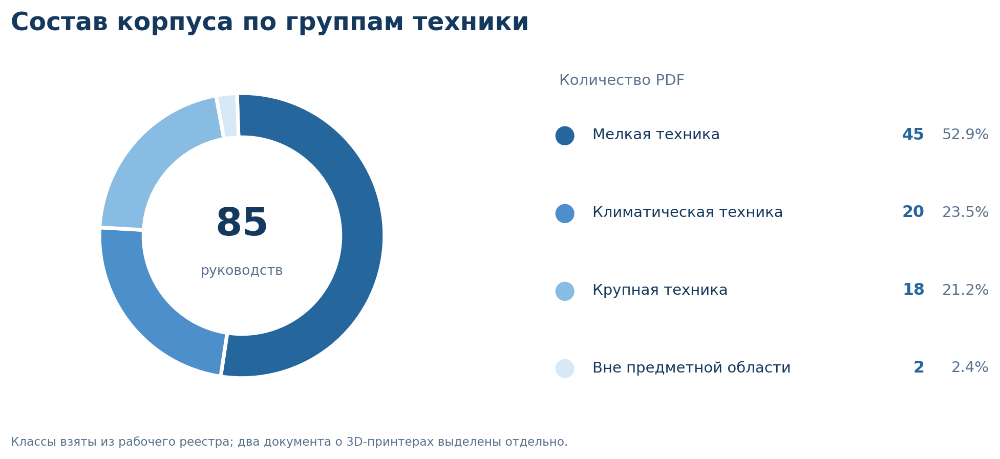

*Рис. 1. Распределение PDF по укрупнённым группам техники.*

Наиболее широко представлены кофемашины (11 руководств), газовые котлы и водонагреватели (9), варочные панели и плиты (5). В корпус также входят инструкции к посудомоечным и стиральным машинам, холодильникам, духовкам, пылесосам, мультиваркам и климатической технике.

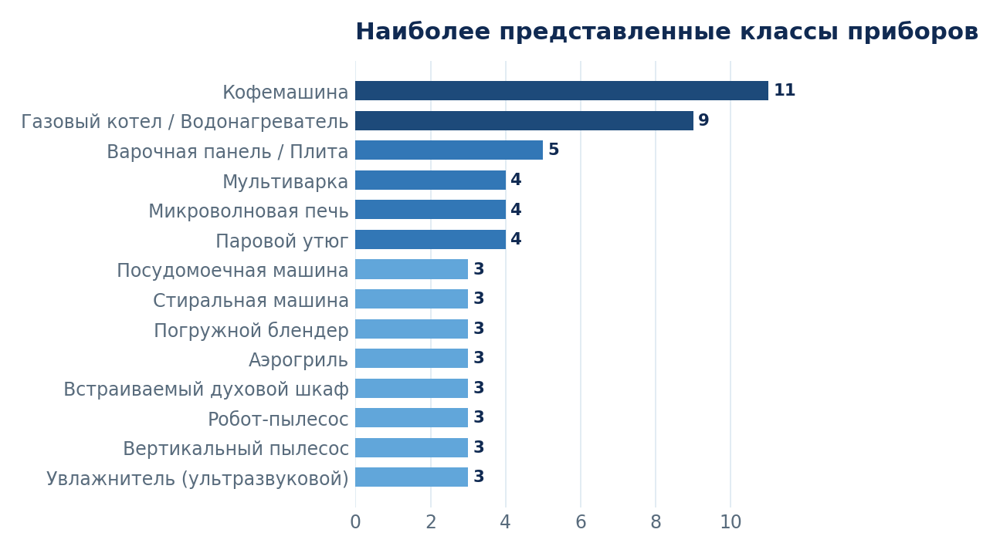

*Рис. 2. Наиболее представленные категории устройств.*

Состав корпуса позволяет проверять систему на разных типах документов, а не только на одной категории техники. Два PDF с описанием 3D-принтеров учитываются в исходной статистике, но не предназначены для основного набора бытовых приборов.

### 2.2. Бренды и размер документов

По числу инструкций лидируют **Bosch (18), De’Longhi (11) и Panasonic (8)**. Вместе это 37 PDF, или 43,5% корпуса; оставшиеся документы относятся к 21 бренду.

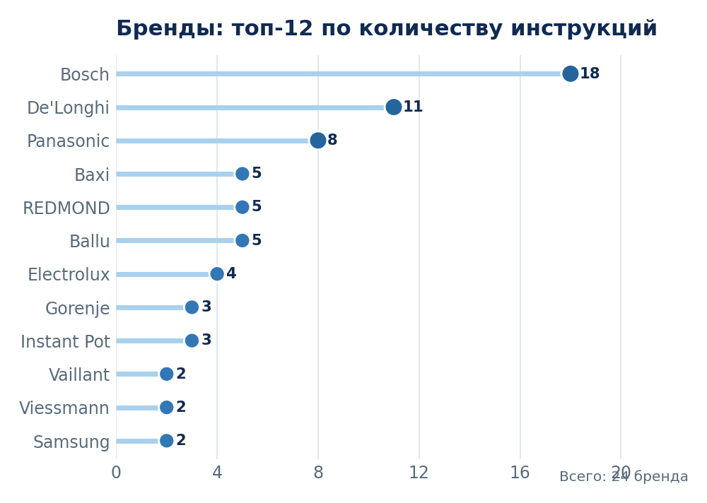

*Рис. 3. Число руководств для наиболее представленных брендов.*

Руководства заметно различаются по объёму: от **2 до 456 страниц**, при медиане **38** и среднем значении **59,1 страницы**. Для RAG это означает, что разбиение документа на фрагменты нужно сопровождать метаданными о модели и странице, особенно в длинных многораздельных инструкциях.

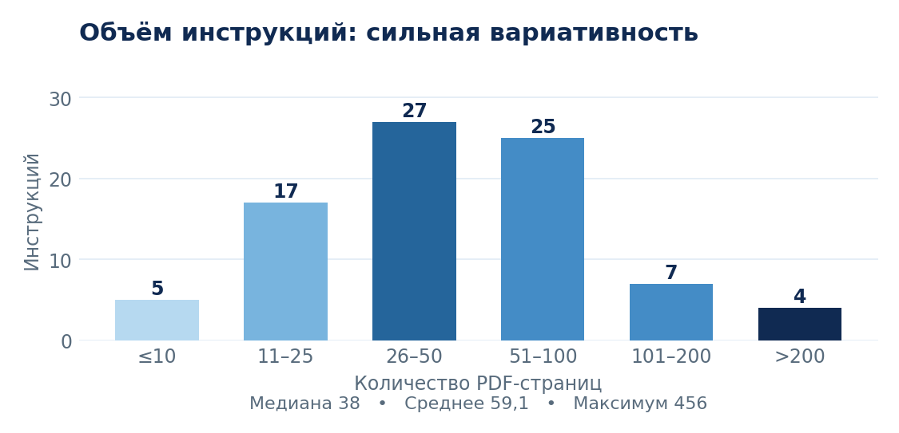

*Рис. 4. Распределение PDF по количеству страниц.*

### 2.3. Графика, таблицы и текстовый слой

Инструкции содержат не только текстовые описания. По автоматической классификации **3 143 страницы (62,6%)** относятся к страницам с графикой, ещё **1 023 (20,4%)** – к табличным. Преимущественно текстовых страниц – **654 (13,0%)**. Остальные выделены как страницы без извлекаемого текста или возможные сканы.

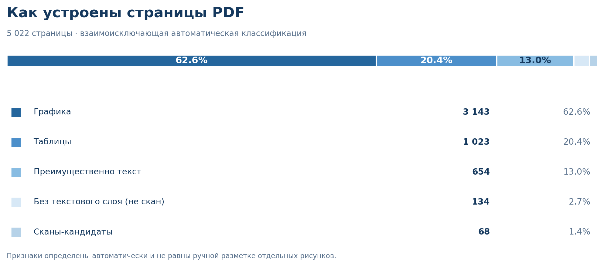

*Рис. 5. Типы страниц по автоматическим признакам. Группы не пересекаются.*

На **202 страницах (4,0%)** текст не извлекается напрямую из PDF. Для **351 страницы (7,0%)** объём извлечённого текста составляет менее 100 символов. Есть и обратная проблема: на одной из страниц MAN-45 после извлечения получилось более миллиона символов, почти целиком состоящих из пробелов. Такие примеры показывают, зачем перед индексацией нормализовать текст, проверять таблицы и при необходимости использовать OCR или визуальный анализ страниц.

### 2.4. Языки и особенности извлечения

Инструкции могут включать сразу несколько языков. Автоматически к английскому отнесены **1 664 страницы (33,1%)**, к русскому – **1 036 (20,6%)**. На 1 636 страницах определены другие языки, ещё на 686 язык не удалось установить.

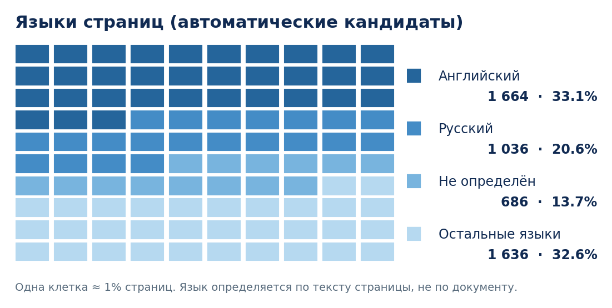

*Рис. 6. Распределение страниц по автоматически определённому языку.*

При индексации русскоязычные разделы можно выделять отдельно, сохраняя общие схемы и таблицы, на которые ссылаются инструкции на разных языках. Медианный объём извлечённого текста одного PDF – **10 863 токена**, а максимальный – **55 627 токенов**. Размер файла сам по себе не показывает, сколько в нём пригодного для поиска текста: часть объёма занимают изображения.

<strong>Дополнительная сводная визуализация корпуса</strong>

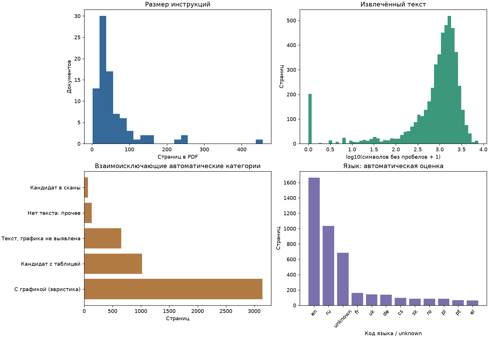

*Рис. 7. Длина документов, объём извлечённого текста, типы страниц и языки.*

### 2.5. Повторяющиеся страницы и проверка реестра

Все 85 PDF удалось открыть, и **полных дубликатов файлов не обнаружено**. Вместе с тем выявлены **26 повторяющихся текстовых страниц**. Например, совпадающие фрагменты встречаются в MAN-37/MAN-40 и MAN-42/MAN-46. Это ожидаемо для руководств к близким модельным линейкам; при разделении вопросов на обучающую и тестовую выборки такие семейства стоит учитывать вместе.

При сверке с содержимым PDF были уточнены записи MAN-15 (индукционная варочная панель Bosch) и MAN-18 (посудомоечная машина Bosch). Их категории и модельные семейства в реестре уже исправлены. Отдельно отмечены MAN-19, для которого требуется полное руководство, и два непрофильных документа о 3D-принтерах. Если убрать эти три файла, корпус будет насчитывать **82 инструкции на 4 883 страницах**. Далее в отчёте приведена статистика исходного набора из 85 PDF.

---

## 3. EDA банка вопросов

### 3.1. Состав и покрытие

Всего подготовлен **131 вопрос к 85 инструкциям**. Из них **56 (42,7%)** основаны на внешних источниках и **75 (57,3%)** составлены участниками проекта. Каждая инструкция представлена хотя бы одним вопросом. При этом у 57 документов пока только по одному вопросу – банк охватывает весь корпус, но дальнейшее пополнение позволит проверить разные сценарии для одной модели.

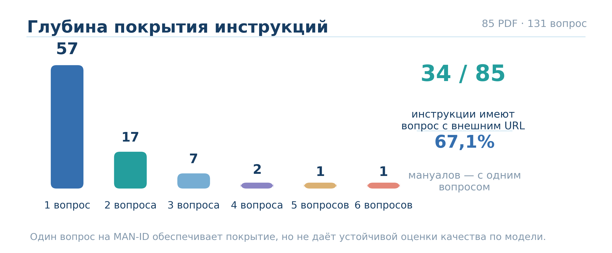

*Рис. 8. Насколько подробно вопросы покрывают каждую инструкцию.*

### 3.2. Какие материалы нужны для ответа

В **94 из 131 вопросов (71,8%)** в эталонной разметке явно указаны таблица, изображение, схема или сочетание форматов. Ещё 12 вопросов обозначены как `Mixed` без более подробного типа. Для 23 вопросов достаточно текстового источника по текущей разметке, для двух тип источника не определён.

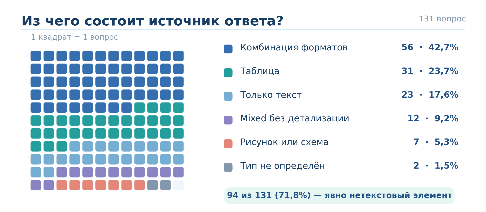

*Рис. 9. Форматы материалов, на которые опираются ответы.*

Эта статистика характеризует **тип источника**, а не процент гарантированных ошибок text-only системы. Некоторые таблицы можно успешно извлечь в виде текста, и окончательный эффект мультимодальности нужно проверить в эксперименте. Однако уже видно, что сохранение структуры таблиц и связей между схемой и подписью важно для рассматриваемых задач.

### 3.3. Внешние вопросы и пользовательский опыт

Вопросы с внешними ссылками поступили из нескольких независимых площадок. Больше всего их с Яндекс Маркета (12), Ozon (11), Best Buy (11) и Reddit (6). Другие источники расширяют разнообразие формулировок и пользовательских ситуаций.

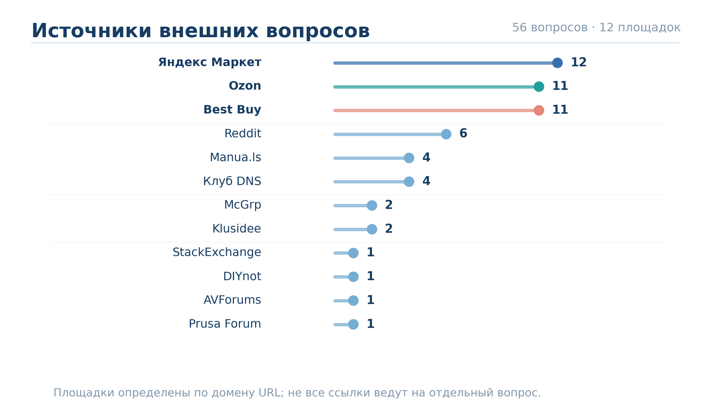

*Рис. 10. Количество вопросов с URL по площадкам.*

Авторские вопросы чаще направлены на проверку таблиц, изображений и обозначений на схемах: таких **64 из 75 (85,3%)**. Это было частью плана формирования benchmark. При этом среди вопросов с внешних площадок структурированные или визуальные источники нужны в **30 из 56 случаев (53,6%)**. Следовательно, мультимодальность актуальна не только для специально придуманных технических задач, но и для обращений покупателей.

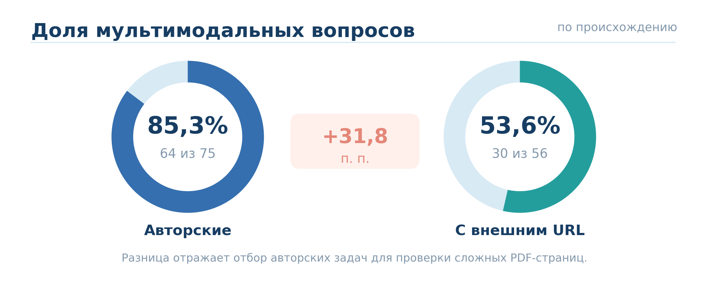

*Рис. 11. Доля вопросов с явно указанными таблицами, изображениями и схемами для двух групп источников.*

### 3.4. Темы пользовательских запросов

Вопросы сгруппированы по основной цели пользователя. Чаще всего речь идёт об эксплуатации и настройках (35), диагностике неисправностей (26), а также об устройстве техники и элементах схем (19). Встречаются вопросы об установке, характеристиках, уходе, совместимости и безопасности.

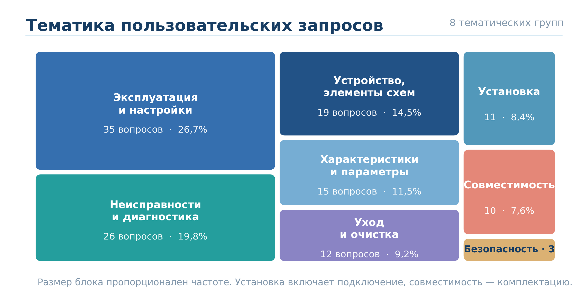

*Рис. 12. Тематические группы пользовательских запросов; площадь блока соответствует числу вопросов.*

Особенно часто визуально-структурированные материалы используются в вопросах об элементах устройства (**18 из 19**) и диагностике (**22 из 26**). Для ассистента это разные задачи: найти настройку, прочитать строку таблицы ошибок, определить деталь по схеме и дать точную ссылку на страницу.

---

## 4. Общие выводы EDA

**1. Корпус подходит для исследования мультимодального поиска.** Он охватывает разные категории бытовой техники, бренды и языки. Около 83% страниц отнесены автоматическим анализом к графическим или табличным, а на 4% страниц нет доступного текстового слоя. Поэтому наряду с обычным текстовым индексом имеет смысл проверить подходы, которые сохраняют изображения и структуру страниц.

**2. Потребность в визуальной информации подтверждается и вопросами пользователей.** В 71,8% вопросов эталонные ответы ссылаются на таблицы, схемы, изображения или их сочетания. Среди вопросов с внешними URL эта доля составляет 53,6%. Таким образом, мультимодальный поиск нужен не только для составленных специально заданий, но и для типичных пользовательских обращений.

**3. Метаданные и точные ссылки на страницы необходимы для надёжного ответа.** Руководства к родственным моделям могут иметь общие фрагменты. Поэтому важно фильтровать документы по бренду и модели, сохранять страницы-источники и проверять, достаточно ли в найденном фрагменте информации. В банке есть как минимум шесть явно отмеченных вопросов, для которых инструкция не даёт полного ответа.

### Следующий этап исследования

Сравним **text-only RAG** с вариантом, который учитывает таблицы и визуальные страницы. Оценим качество поиска релевантных страниц (`Recall@5`), корректность ответа и качество цитирования. Результаты будем рассматривать отдельно для авторских задач, внешних пользовательских вопросов, табличных ответов и вопросов по схемам.

> **Важно для интерпретации.** Доля вопросов со схемами и таблицами не равна доле задач, на которые принципиально нельзя ответить по тексту. Эту долю покажет сравнение систем на одних и тех же вопросах.

---

## 5. Данные и методика

- [Реестр инструкций (Google Sheets)](https://docs.google.com/spreadsheets/d/1f2HkJeWjz4jDuKwngFnSle41falRVxVjxTE8xhjaHYE/edit) – метаданные, категории, модели и результаты сверки документов.
- [Банк вопросов (Google Sheets)](https://docs.google.com/spreadsheets/d/1_j7oWTQGm9XBNkeFyd4L67_mA_tow7KE67nE0IsV1wA/edit) – формулировки, источники, эталонные ответы и привязки к руководствам.
- [Полная версия EDA (Google Docs)](https://docs.google.com/document/d/1eHSE9a3qsbgTl_w8lufTnGSJUmajbBfG4FGfDq1cbIg/edit) – исходный отчёт с графиками.

**Как считались показатели.** Категории страниц и языки определялись автоматически при разборе PDF; распределение тематик вопросов – первичная содержательная классификация формулировок. Тип материала ответа восстановлен из разметки банка вопросов. Статистика относится к состоянию корпуса на ноябрь 2026 года и будет уточняться при подготовке финального benchmark.
